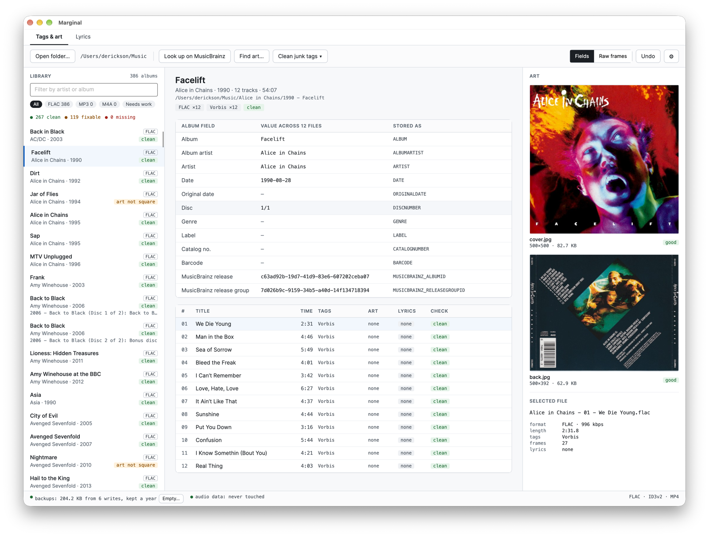
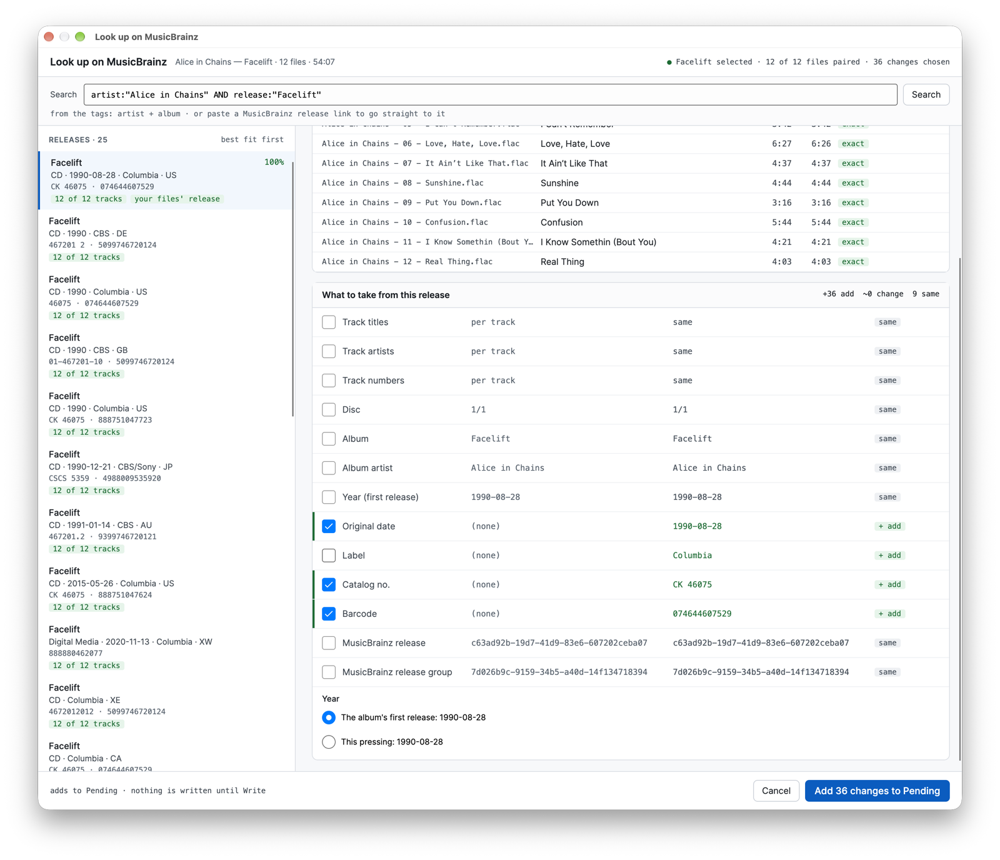
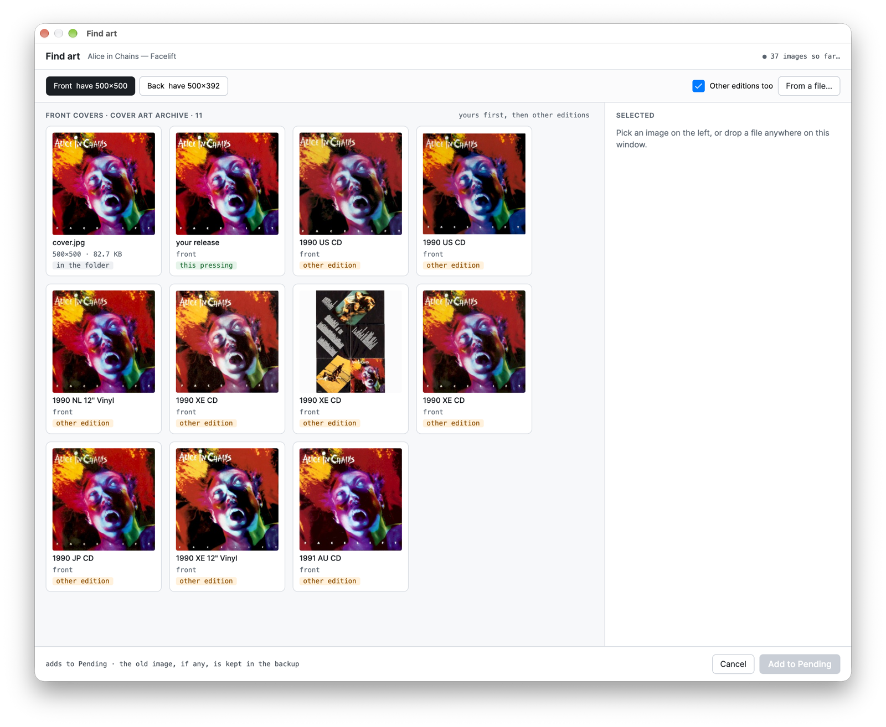
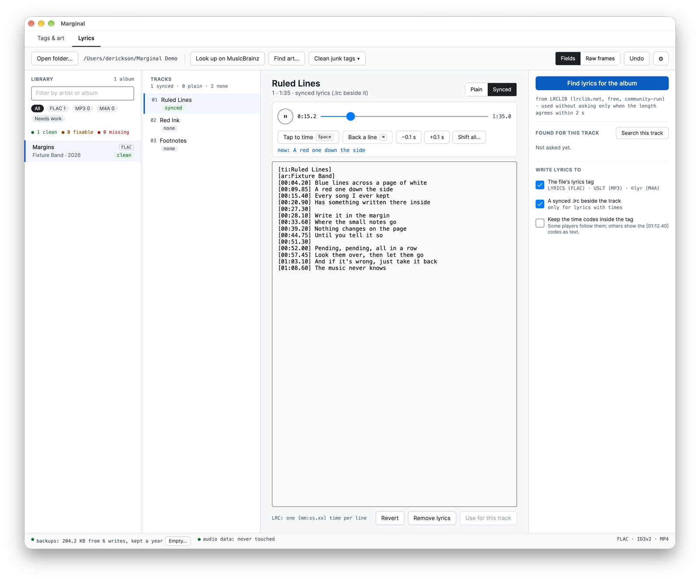

# Marginal

*Notes in the margins of your music library.*

A desktop editor for the tags, cover art and lyrics of a music library you
own: FLAC, MP3 and M4A. Open a folder and see exactly what every file holds.
Fix it by hand, or from MusicBrainz, the Cover Art Archive and LRCLIB. See
every change before it is made, then write it safely. The audio is never
touched.

A companion to [AlbumWall](https://github.com/gsa700/albumwall) and
[Deadwax](https://github.com/gsa700/deadwax), and useful without them.
macOS, Linux and Windows. Free software, GPLv3.

## What it does

- **Shows what is there.** Every album in the folder, marked clean, fixable
  or missing something. Each album's fields across all its files, with the
  key each is stored under (`ALBUMARTIST`, `TPE2`, `aART`); the raw frames
  of any file; the cover and back beside the tracks and the art inside them.
  It flags values that differ between tracks, a missing album artist, ID3v1
  and APE leftovers, small or non-square art, and embedded art that differs
  from `cover.jpg`.
- **Nothing is written until Write.** Every edit goes to a Pending list,
  each line marked `+ add`, `~ change` or `− remove`, where it can be looked
  over and discarded.
- **Writes safely.** Each file is copied, the copy changed and read back
  (the fields asked for changed, every other frame and picture as it was,
  the audio bytes identical), the original's tags backed up, and only then
  is the copy put in its place, in one rename.
- **Undo, for a year.** A backup holds only what is not audio (about 100 KB
  for an album), and Undo rebuilds each original byte for byte. One Undo
  takes back a whole write, even one across the library.
- **MusicBrainz lookup.** From the tags or a pasted release link. The
  release the files are already tagged with comes first, then matching track
  counts; tracks are paired by number and length, and a checklist says what
  to take. Nothing is ticked when the fit is poor.
- **Cover art.** The archive's images for your release and other editions,
  shown as they arrive, with what is already in the folder first. Keep, crop
  or pad to square, resize, strip camera metadata; save as `cover.jpg` or
  `back.jpg`, embed the front, or both.
- **Lyrics.** Plain and synced (LRC), in the file's lyrics tag and a `.lrc`
  beside the track. LRCLIB for one track or the whole album; a match goes in
  unasked only when its length agrees within 2 seconds and the artist and
  title match. Play the track and press Space as each line starts to time
  it, with Backspace to step back a line.
- **Library-wide clean-up.** Junk tags across every album, each change
  shown first, written as one batch and undone as one.
- **From AlbumWall.** AlbumWall's album menu has *Edit in Marginal…*, which
  opens that album here (or *Get Marginal…* when it is not installed).

Network shares open read-only: a rename over SMB or NFS is not always
atomic, so Marginal writes only to local libraries, and a copy to the NAS
carries the edits.

## Download

Each [release](https://github.com/gsa700/marginal/releases) carries one file
per platform:

| your machine | the file |
|---|---|
| Windows 10 or 11 (64-bit) | `Marginal-win-x64-aot.zip` |
| a Linux PC with glibc 2.34 or later (Ubuntu 22.04, Debian 12, RHEL 9, Fedora 35 and newer) | `Marginal-linux-x64-aot.zip` |
| a Mac with Apple silicon, macOS 13 or later | `Marginal.dmg` |

- **Windows and Linux:** unpack the zip; it makes a `Marginal` folder. Run
  `Marginal` (`Marginal.exe` on Windows) from there. Keep the library files
  beside it: they are part of it. It offers to install itself (below).
  Windows may say "Windows protected your PC" the first time, because the
  program is not signed: More info, then Run anyway.
- **Mac:** open `Marginal.dmg` and drag Marginal to Applications. It is
  signed with a Developer ID and notarized by Apple, so it opens with no
  warning. (`Marginal-osx-arm64.zip` holds the same app, for the updater.)

It is a native program (.NET Native AOT): nothing else needs installing.

### Updates

A copy checks GitHub for a newer release a few seconds after it starts and
shows a dot on the gear when there is one. Preferences > Updates installs it:
the download is checked against the release's `SHA256SUMS` (on a Mac, also
for the Developer ID signature and Apple's notarization), and Marginal
restarts into it. If the new version does not start, the old one is put back.
It will not update while edits are waiting in Pending.

There are two channels. **Edge** gets every build as it is released (GitHub
pre-releases); **Stable**, the default, gets a build once it has run on Edge
without trouble and been promoted, the same binary with its pre-release flag
cleared. *0.1.0 is on Edge for now:* until Stable has a release, tick Edge in
Preferences > Updates to be offered the next one.

### Install

On Windows and Linux, run it from wherever you unpacked it and it offers to
install, per user and without administrator rights: into
`%LocalAppData%\Programs\Marginal` on Windows (in Installed apps, with a
Start Menu shortcut) or `~/.local/share/marginal` on Linux (in the
applications menu). `--install` and `--uninstall` do the same from a
terminal; add `--quiet` for scripts. Uninstalling removes the program; your
music, your settings and the backups stay. To run it from a folder and
register nothing, put an empty file named `portable.txt` beside it.

On a Mac it installs the Mac way, into Applications, and updates itself in
place there.

## Your files and your privacy

- **Settings:** `~/.config/marginal/settings.json`.
- **Backups:** macOS `~/Library/Application Support/marginal/backups`,
  Linux `~/.local/state/marginal/backups`, Windows
  `%LOCALAPPDATA%\marginal\backups`. One folder per write; the size is on
  the status bar, with a button to empty them.
- **What leaves the machine:** only when you ask, and only what the lookup
  needs. Artist, album and track count, or a release ID, go to MusicBrainz;
  release IDs to the Cover Art Archive; artist, title, album and length to
  LRCLIB; and an update check to GitHub. Nothing else, and nothing in the
  background but the update check, which can be turned off.
- Lyrics are copyrighted. Marginal fetches them, on request, for files you
  own, and says where they came from.

## Building it

.NET 10 SDK. `dotnet build` and `dotnet test` from the top. Release builds
are Native AOT: `tools/install.sh` builds one for this Linux machine and
installs it (it needs clang and zlib's development files);
`tools/make-macos-app.sh --install` builds `Marginal.app` into Applications.
The design is in [docs/spec.md](docs/spec.md), what comes next in
[docs/roadmap.md](docs/roadmap.md).

Parts are shared with the other two: the audio decoders and player come from
AlbumWall, the MusicBrainz client and the install and update code from
Deadwax. [THIRD-PARTY-NOTICES.md](THIRD-PARTY-NOTICES.md) names what is
used from elsewhere (Avalonia, TagLib#, SkiaSharp and more) and their
licenses are in [licenses/](licenses/).

## License

GPLv3. See [LICENSE](LICENSE).
